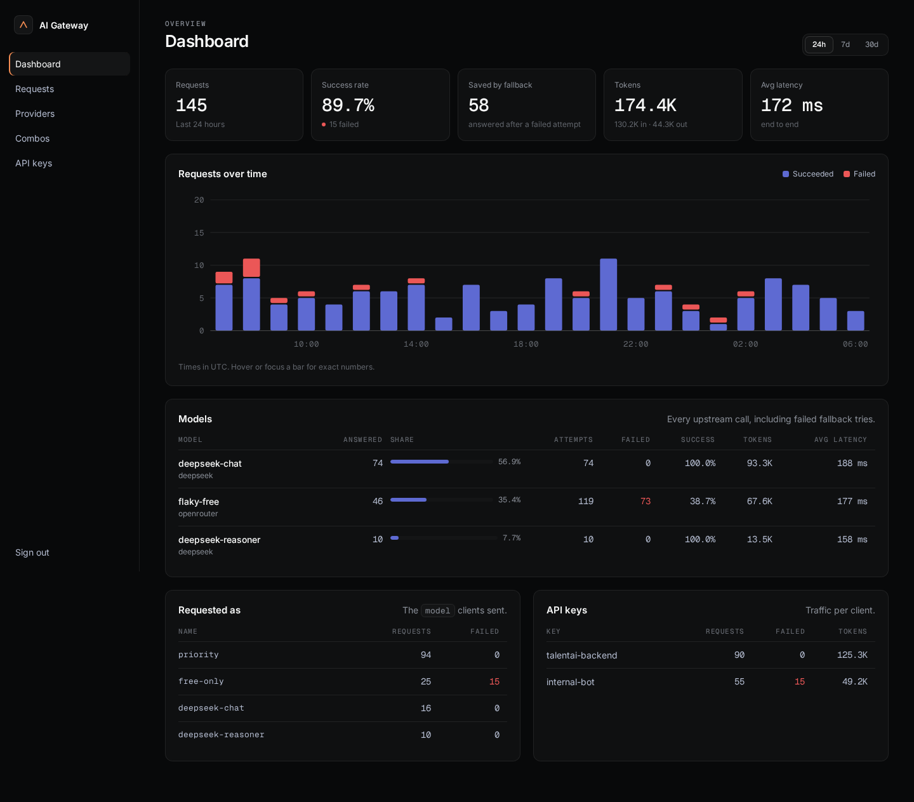

# AI Gateway

A small, self-hosted gateway that puts one **OpenAI-compatible endpoint** in front of all your
model providers. Clients ask for a model name; the gateway tries the providers you configured
**in priority order** and falls back to the next one when a call fails. Every request and every
upstream attempt is recorded, so you can see which model answered, how often fallback saved a
request, and how many tokens each app used.

Built with Rust, [Actix Web](https://actix.rs), [Askama](https://github.com/askama-rs/askama)
templates and SQLite. One binary, no external services.



## Features

- **OpenAI-compatible API**: `POST /v1/chat/completions`, `/v1/completions`, `/v1/embeddings`,
  `GET /v1/models`. Existing OpenAI SDKs work by changing the base URL.
- **Any OpenAI-compatible provider**: OpenRouter, DeepSeek, Groq, Together, vLLM, Ollama, LM
  Studio, your own proxy…
- **Priority fallback (combos)**: a combo is a model name such as `priority` that maps to an
  ordered list of models. Connection errors, timeouts, non-2xx answers and 2xx answers without
  `choices` move on to the next model.
- **Streaming** (SSE) is passed through unchanged. Fallback applies until the upstream sends its
  status line; token usage is read from the final chunk (`stream_options.include_usage` is added
  for you).
- **Statistics**: requests, success rate, requests saved by fallback, prompt/completion tokens,
  latency, per model, per requested name and per API key, over 24 h / 7 d / 30 d.
- **Request log** with every attempt, its status, latency and error.
- **Client API keys**: one per app, stored as SHA-256 hashes, can be disabled at any time.
- **Admin UI** to manage providers (with one-click model import from `/models`), combos and keys.

## Quick start

```sh
git clone https://github.com/Azedevco/ai-gateway
cd ai-gateway
cp .env.example .env        # set ADMIN_PASSWORD and SESSION_SECRET
cargo run --release
```

Open <http://127.0.0.1:8090>, sign in, then:

1. **Providers → Add provider**: name, base URL (e.g. `https://api.deepseek.com/v1`) and API key.
   On the provider page press **Import from /models** or add model ids by hand.
2. **Combos → New combo**: e.g. `priority`, then add models in the order they should be tried.
3. **API keys → Create key** for each app. The key is shown once.

Call it like OpenAI:

```sh
curl http://127.0.0.1:8090/v1/chat/completions \
  -H "Authorization: Bearer agw_..." \
  -H "Content-Type: application/json" \
  -d '{"model": "priority", "messages": [{"role": "user", "content": "Hello"}]}'
```

```python
from openai import OpenAI

client = OpenAI(base_url="http://127.0.0.1:8090/v1", api_key="agw_...")
client.chat.completions.create(model="priority", messages=[{"role": "user", "content": "Hello"}])
```

Responses carry `X-Gateway-Provider`, `X-Gateway-Model` and `X-Gateway-Attempts` headers.

## How `model` is resolved

1. A **combo** with that name: its enabled models, top to bottom.
2. A **model id** (e.g. `deepseek-chat`): every enabled provider that has it, oldest provider first.
   Adding the same model to two providers gives you fallback without a combo.
3. **`provider/model`** (e.g. `deepseek/deepseek-chat`): exactly that one.

When every attempt fails the client gets the last upstream status if it was a 4xx, otherwise
`502`, with an OpenAI-style error naming the last failure.

## Configuration

All settings are environment variables (a `.env` file is read on start). See
[`.env.example`](.env.example).

| Variable | Default | |
|---|---|---|
| `GATEWAY_BIND` | `127.0.0.1:8090` | Listen address |
| `DATABASE_URL` | `sqlite://data/gateway.db` | SQLite file, created if missing |
| `ADMIN_PASSWORD` | — (required) | Admin UI password, 8+ characters |
| `SESSION_SECRET` | — (required) | 64+ characters, signs the session cookie |
| `SECURE_COOKIES` | `0` | Set `1` when the UI is served over HTTPS |
| `RETENTION_DAYS` | `90` | Request log retention; `0` keeps everything |
| `RUST_LOG` | `info,sqlx=warn` | Log filter |

Per provider you also set a **timeout** (whole response for normal calls, time to first byte for
streams).

## Deployment

The gateway is meant for a private network or VPN. Provider API keys are stored in the SQLite
file in plain text, so protect that file and do not expose the admin UI to the internet.

**systemd**: build with `cargo build --release`, copy `target/release/ai-gateway` and `.env` to
`/opt/ai-gateway/`, then install [`deploy/ai-gateway.service`](deploy/ai-gateway.service).

**Docker**:

```sh
docker build -t ai-gateway .
docker run -d --name ai-gateway -p 127.0.0.1:8090:8090 \
  -e ADMIN_PASSWORD=... -e SESSION_SECRET=... \
  -v ai-gateway-data:/app/data ai-gateway
```

## Project layout

```
src/
  main.rs          server start-up
  lib.rs           app state and route registration
  config.rs        environment configuration
  db.rs            SQLite pool, migrations, log retention
  models/          data access (providers, models, combos, keys, request log, stats)
  services/        router (model -> ordered targets) and upstream (calls, fallback, streaming)
  controllers/     HTTP handlers: api.rs for clients, the rest for the admin UI
  views.rs         formatting helpers and chart geometry for templates
templates/         Askama HTML templates
static/app.css     styles
migrations/        SQL schema
tests/proxy.rs     end-to-end tests against a mock upstream
```

## Development

```sh
cargo test                                  # unit + end-to-end tests
cargo clippy --all-targets -- -D warnings
cargo fmt
```

## License

[MIT](LICENSE) © Azedev
